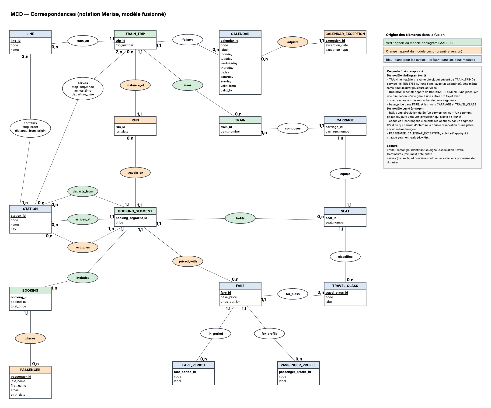
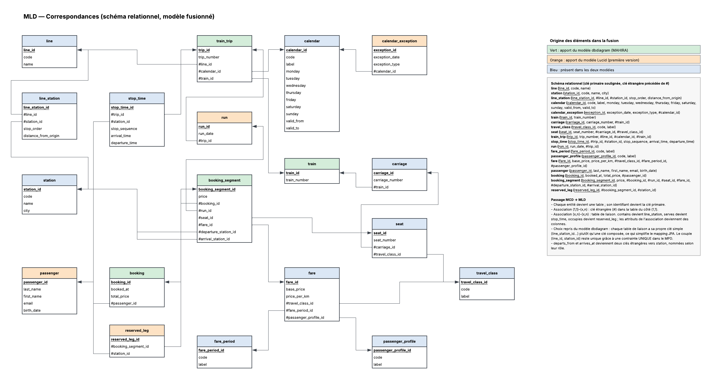
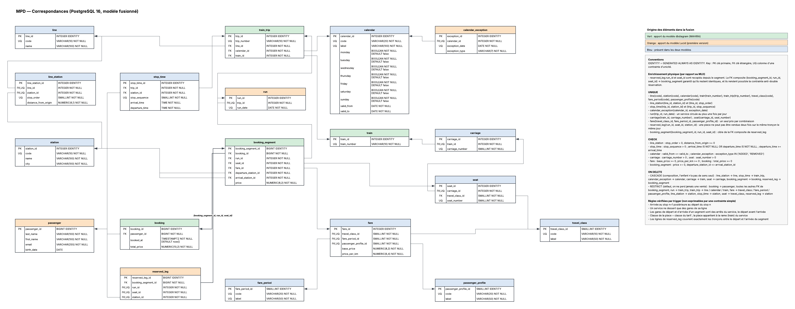

# Modélisation — Correspondances

Ce document présente le modèle de données de la billetterie TER, dans l'ordre du cycle Merise : **MCD → MLD → MPD**. Chaque niveau est donné en image, suivi de l'explication des choix.

Le modèle est la fusion de deux propositions de l'équipe : un premier modèle fait sous Lucidchart et un modèle fait sous dbdiagram (Mahira). Sur les schémas, la couleur de chaque élément indique son origine (voir la section 5).

Source éditable des schémas : [Lucidchart](https://lucid.app/lucidchart/373e9a3b-7e2e-45ea-b7ca-ea1360b614ae/edit)

---

## 1. Le domaine en quelques phrases

- Le **réseau** est fait de gares (`station`) reliées par des lignes (`line`). Une ligne passe par ses gares dans un ordre donné, et une gare peut appartenir à plusieurs lignes : c'est là que se font les correspondances.
- Un **service** (`train_trip`, par exemple le TER 8756) roule sur une ligne, selon un **calendrier**. Il dessert certaines gares de sa ligne, avec une heure d'arrivée et de départ pour chacune. Un train direct saute des gares.
- Un service est assuré par une **rame** (`train`), composée de **voitures** (`carriage`) qui contiennent des **places** (`seat`) d'une **classe** donnée.
- Le **tarif** dépend de la distance, de la classe, de la période (creuse, pointe, vacances) et du profil voyageur.
- Un **voyageur** fait un **achat** (`booking`) qui contient un ou plusieurs **segments** (`booking_segment`) : une place, sur une circulation datée, d'une gare de départ à une gare d'arrivée. Un trajet avec correspondance donne donc un seul achat de deux segments.

---

## 2. MCD — Modèle conceptuel



Notation Merise : entité en rectangle avec l'identifiant souligné, association en ovale avec ses éventuels attributs, cardinalités (min,max) écrites côté entité.

### Entités

| Entité | Rôle |
|---|---|
| `STATION` | Une gare du réseau |
| `LINE` | Une ligne, suite ordonnée de gares |
| `CALENDAR` | Jours de circulation (lundi … dimanche, période de validité) |
| `CALENDAR_EXCEPTION` | Date ajoutée ou supprimée par rapport au calendrier |
| `TRAIN_TRIP` | Un service : un numéro de train sur une ligne, avec un calendrier |
| `RUN` | Une circulation : un service **à une date précise** |
| `TRAIN` | Une rame physique (le matériel) |
| `CARRIAGE` | Une voiture de la rame, numérotée |
| `SEAT` | Une place numérotée dans une voiture |
| `TRAVEL_CLASS` | Classe de confort (1re, 2nde) |
| `FARE_PERIOD` | Période tarifaire (creuse, pointe, vacances) |
| `PASSENGER_PROFILE` | Profil voyageur (plein tarif, jeune, senior, abonné) |
| `FARE` | Un tarif : prix de base + prix au km, pour une combinaison classe × période × profil |
| `PASSENGER` | Un voyageur |
| `BOOKING` | Un achat, qui regroupe un ou plusieurs segments |
| `BOOKING_SEGMENT` | Une place réservée sur une circulation, d'une gare à une autre |

### Choix de modélisation

**La desserte est une association porteuse de données.**
`serves` relie `TRAIN_TRIP` et `STATION` et porte `stop_sequence`, `arrival_time` et `departure_time`. Ce n'est pas une simple clé étrangère : la relation est plusieurs-à-plusieurs et chaque passage a ses propres horaires. Un train direct n'a tout simplement pas de desserte dans les gares qu'il saute.

**L'appartenance d'une gare à une ligne est aussi porteuse de données.**
`contains` relie `LINE` et `STATION` et porte `stop_order` (rang de la gare sur la ligne) et `distance_from_origin`. La distance sert au calcul du prix d'un trajet.

**Le matériel est séparé du service.**
`TRAIN` est la rame physique, `TRAIN_TRIP` est le service commercial. Une même rame peut assurer plusieurs services, et le sujet distingue bien « les circulations » et « le matériel ».

**La circulation datée est une entité à part entière.**
`RUN` représente un service un jour donné, créé à partir du calendrier et de ses exceptions. Un segment pointe vers un `RUN` : il est donc impossible de réserver un train qui ne circule pas ce jour-là.

**Le tarif dépend de plusieurs dimensions.**
`FARE` est rattaché à une classe, une période et un profil (cardinalités (1,1) côté `FARE`). Le prix d'un segment = `base_price` + `price_per_km` × distance parcourue.

**On réserve un segment, pas un train entier.**
Un segment a une gare de départ (`departs_from`) et une gare d'arrivée (`arrives_at`). L'association `occupies` (1,n) liste les **tronçons élémentaires** occupés par le segment : le tronçon qui part de chaque gare desservie entre le départ et l'arrivée. Si un voyageur descend à mi-parcours, la place reste libre sur les tronçons suivants et peut être revendue.

**Un achat peut contenir plusieurs segments.**
`includes` relie `BOOKING` (1,n) et `BOOKING_SEGMENT` (1,1) : un trajet avec correspondance est un seul achat de deux segments, chacun sur sa propre circulation, avec sa propre place et son propre tarif.

**Le prix payé est figé dans le segment.**
`BOOKING_SEGMENT.price` est recopié au moment de l'achat. Un changement de tarif ultérieur ne modifie pas les billets déjà vendus.

---

## 3. MLD — Modèle logique



### Règles de passage MCD → MLD

- Chaque entité devient une table ; son identifiant devient la clé primaire.
- Association (1,1)–(x,n) : la table du côté (1,1) reçoit une clé étrangère.
- Association (x,n)–(x,n) : elle devient une table de liaison, et ses attributs deviennent des colonnes :
  - `contains` → `line_station`
  - `serves` → `stop_time`
  - `occupies` → `reserved_leg`
- `departs_from` et `arrives_at` deviennent deux clés étrangères vers `station`, nommées selon leur rôle : `departure_station_id` et `arrival_station_id`.

**Clé simple pour chaque table de liaison.** Plutôt qu'une clé primaire composée, chaque table de liaison a sa propre clé (`line_station_id`, `stop_time_id`, `reserved_leg_id`). Le mapping JPA est plus simple (pas de `@EmbeddedId`), et l'unicité du couple est garantie par une contrainte `UNIQUE` dans le MPD.

### Schéma relationnel

Clé primaire soulignée sur le schéma, clé étrangère précédée de `#`.

```
line              (line_id, code, name)
station           (station_id, code, name, city)
line_station      (line_station_id, #line_id, #station_id, stop_order, distance_from_origin)
calendar          (calendar_id, code, label, monday, tuesday, wednesday, thursday, friday, saturday, sunday, valid_from, valid_to)
calendar_exception(exception_id, exception_date, exception_type, #calendar_id)
train             (train_id, train_number)
carriage          (carriage_id, carriage_number, #train_id)
travel_class      (travel_class_id, code, label)
seat              (seat_id, seat_number, #carriage_id, #travel_class_id)
train_trip        (trip_id, trip_number, #line_id, #calendar_id, #train_id)
stop_time         (stop_time_id, #trip_id, #station_id, stop_sequence, arrival_time, departure_time)
run               (run_id, run_date, #trip_id)
fare_period       (fare_period_id, code, label)
passenger_profile (passenger_profile_id, code, label)
fare              (fare_id, base_price, price_per_km, #travel_class_id, #fare_period_id, #passenger_profile_id)
passenger         (passenger_id, last_name, first_name, email, birth_date)
booking           (booking_id, booked_at, total_price, #passenger_id)
booking_segment   (booking_segment_id, price, #booking_id, #run_id, #seat_id, #fare_id, #departure_station_id, #arrival_station_id)
reserved_leg      (reserved_leg_id, #booking_segment_id, #station_id)
```

---

## 4. MPD — Modèle physique (PostgreSQL 16)



### Types

| Choix | Raison |
|---|---|
| `INTEGER` / `BIGINT GENERATED ALWAYS AS IDENTITY` | Clé technique générée par la base. `BIGINT` pour les tables volumineuses (`passenger`, `booking`, `booking_segment`, `reserved_leg`). |
| `SMALLINT` | Petites tables de référence et numéros (classe, période, profil, numéro de voiture ou de place, rang). |
| `NUMERIC(p,s)` | Montants et distances : jamais de `FLOAT` pour de l'argent (erreurs d'arrondi). |
| `TIMESTAMPTZ` | `booked_at`, avec fuseau horaire. |
| `DATE` / `TIME` | Date de circulation, horaires de passage. |
| `VARCHAR(n)` | Codes et libellés, avec une longueur maximale réaliste. |

### Enrichissement physique

`reserved_leg` recopie `run_id` et `seat_id` depuis son segment. Une clé étrangère composite `(booking_segment_id, run_id, seat_id)` → `booking_segment` garantit que ces copies restent identiques à l'original. Ces deux colonnes rendent possible la contrainte centrale du sujet :

```sql
UNIQUE (run_id, seat_id, station_id)   -- sur reserved_leg
```

Une place ne peut pas être vendue deux fois sur le même tronçon, le même jour.

### Contraintes UNIQUE

| Table | Colonnes | Règle métier |
|---|---|---|
| `line`, `station`, `calendar`, `travel_class`, `fare_period`, `passenger_profile` | `code` | Code métier unique |
| `train` | `train_number` | Une rame = un numéro |
| `train_trip` | `trip_number` | Un service = un numéro |
| `line_station` | `(line_id, station_id)` et `(line_id, stop_order)` | Une gare une seule fois par ligne, un rang par gare |
| `stop_time` | `(trip_id, station_id)` et `(trip_id, stop_sequence)` | Un passage par gare et par service |
| `calendar_exception` | `(calendar_id, exception_date)` | Une exception par date |
| `run` | `(trip_id, run_date)` | Un service circule au plus une fois par jour |
| `carriage` | `(train_id, carriage_number)` | Numéro de voiture unique dans la rame |
| `seat` | `(carriage_id, seat_number)` | Numéro de place unique dans la voiture |
| `fare` | `(travel_class_id, fare_period_id, passenger_profile_id)` | Un seul prix par combinaison |
| `reserved_leg` | `(run_id, seat_id, station_id)` | Pas de double réservation d'un tronçon |
| `booking_segment` | `(booking_segment_id, run_id, seat_id)` | Cible de la FK composite de `reserved_leg` |

### Contraintes CHECK

| Table | Condition |
|---|---|
| `line_station` | `stop_order > 0`, `distance_from_origin >= 0` |
| `stop_time` | `stop_sequence > 0`, `arrival_time IS NOT NULL OR departure_time IS NOT NULL`, `departure_time >= arrival_time` |
| `calendar` | `valid_from <= valid_to` |
| `calendar_exception` | `exception_type IN ('ADDED', 'REMOVED')` |
| `carriage` / `seat` | `carriage_number > 0` / `seat_number > 0` |
| `fare` | `base_price >= 0`, `price_per_km >= 0` |
| `booking` | `total_price >= 0` |
| `booking_segment` | `price >= 0`, `departure_station_id <> arrival_station_id` |

### Comportement à la suppression (ON DELETE)

| Choix | Clés étrangères | Justification |
|---|---|---|
| `CASCADE` | `line_station → line`, `stop_time → train_trip`, `calendar_exception → calendar`, `carriage → train`, `seat → carriage`, `booking_segment → booking`, `reserved_leg → booking_segment` | Composition : l'enfant n'a pas de sens sans son parent. |
| `RESTRICT` | `booking → passenger`, toutes les autres FK de `booking_segment`, `run → train_trip`, `train_trip → line / calendar / train`, `fare → travel_class / fare_period / passenger_profile`, `line_station → station`, `stop_time → station`, `seat → travel_class`, `reserved_leg → station` | On ne supprime jamais une donnée qui a servi à une vente. |

### Règles vérifiées par trigger

Ces règles portent sur plusieurs lignes ou plusieurs tables, une contrainte déclarative ne peut pas les exprimer :

1. L'arrivée au passage *n+1* est postérieure au départ du passage *n* d'un même service.
2. Un service ne dessert que des gares de sa ligne.
3. Les gares de départ et d'arrivée d'un segment sont des arrêts du service, et le départ précède l'arrivée.
4. La classe de la place correspond à la classe du tarif, et la place appartient à la rame du service.
5. Les lignes de `reserved_leg` couvrent exactement les tronçons entre le départ et l'arrivée du segment.

> Principe suivi : une règle métier tenue par la base vaut mieux qu'un `if` dans un service. Un `if` se contourne par un accès SQL direct, un script d'import ou une seconde instance de l'application ; une contrainte, non.

---

## 5. Origine des éléments dans la fusion

| Couleur | Origine | Éléments |
|---|---|---|
| 🟩 Vert | Modèle dbdiagram (Mahira) | `TRAIN` séparé de `TRAIN_TRIP` ; `BOOKING` séparé de `BOOKING_SEGMENT` ; `base_price` ; noms `carriage` et `travel_class` ; clé simple pour chaque table de liaison |
| 🟧 Orange | Premier modèle Lucid | `RUN` (circulation datée) ; `occupies` / `reserved_leg` (anti double réservation) ; `PASSENGER` ; `CALENDAR_EXCEPTION` ; tarif appliqué à chaque segment |
| 🟦 Bleu | Les deux modèles | Réseau, calendrier, matériel, tarifs |

---

## 6. Ce qui n'est volontairement pas dans ce modèle

L'**historique des prix** (étape 5 du sujet) n'est pas anticipé : `fare` n'a pas de période de validité. Cette évolution sera apportée par une migration Flyway sur la base déjà remplie, après le tag `v1`.
